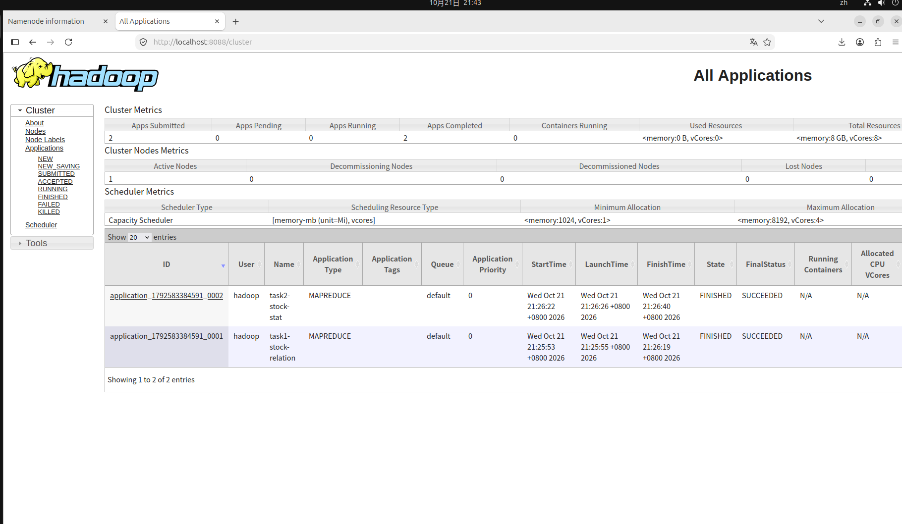

# MapReduce 股票成分股集合关系统计（作业5）
刘东赫 241275032

## 1. 设计思路
本程序使用两个 MapReduce Job 串行执行：
- Job 1：使用 MultipleInputs 分别读取 A.txt 和 B.txt，在 Mapper 端打上 "A" 和 "B" 的标签。Reducer 对同一个（指数编号，股票代码）进行聚合。同时出现为 BOTH，只出现在 A 为 A_ONLY，只出现在 B 为 B_ONLY。
- Job 2：读取 Job 1 的输出结果，以指数编号作为 Key，统计每个指数下 BOTH、A_ONLY、B_ONLY 的数量，并计算总和（并集）。

排序与去重说明：两个 Job 均设置 setNumReduceTasks(1) 保证全局有序（指数编号及股票代码升序）。在 Job 1 的 Reducer 中使用布尔值记录是否出现，实现了同一文件内重复代码的去重。

## 2. 运行环境
- Hadoop 3.3.6 (伪分布式)
- JDK 1.8
- 网络环境受限，未使用 Maven，直接使用 javac 和 jar 手动编译打包。

## 3. 运行结果
任务1结果（部分）：见 output_task1 文件夹。
任务2结果：
101 3 13 4 20
102 3 19 3 25
103 52 195 255 502
(101和102结果与作业示例一致)

## 4. Web 页面截图

## 5. 不足与改进分析
- 性能：当前使用 1 个 Reducer 确保全局排序，当数据量巨大时，单节点会成为性能瓶颈。改进方法可以是使用多个 Reducer 并结合 TotalOrderPartitioner 实现全局排序，或者只保证局部有序。
- 扩展性：Maven 环境由于网络问题未能配置成功，说明实验环境的本地依赖管理还可以优化（比如提前配置好离线 Maven 仓库）。
